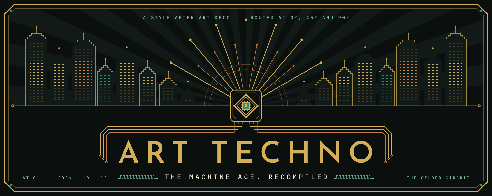

Art Techno does for the computer age what Art Deco did for the machine age:
monumental, symmetrical and luxurious, with circuit-board precision in place of
the machine. This repository holds the work that is meant to be built and
shared: **The Gilded Circuit** web scene and the web-ready 3D models.

The style rules are in [`docs/STYLE.md`](docs/STYLE.md). The complete design record is
[`docs/README.md`](docs/README.md): the mark, The Gilded Circuit and how it is laid out, the nine
Spirits, the Core and the other architecture, the aerial craft, and the design boards. The hero, the
lockups, the social card and the brand board are in [`docs/brand/`](docs/brand/README.md). The design history and the review of every render are kept in
the Art Techno project.

## The seven rules

1. The sun is a processor.
2. Routing at 0°, 45° and 90°.
3. Every line ends in a pad or via.
4. Aliasing is ornament.
5. Light is emitted, not reflected.
6. The figure is a faceted mesh with an idealized human face.
7. Luxury on infrastructure.

Palette: obsidian `#0B100E`, panel `#121A17`, copper `#C77C48`, gold `#D4AF5A`,
solder green `#2F8F74` (under a tenth of any composition), mint `#7FBFA8`,
silkscreen `#EDE6D3`.

## The Spirits

Nine allegorical statues, each a Deco virtue retold for the compute age.

| Spirit | Allegory |
| --- | --- |
| [Spirit of Computation](web/public/renders/computation-engine.jpg) | Thought and calculation |
| [Spirit of Knowledge](web/public/renders/knowledge.jpg) | Wisdom |
| [Ad Astra per Aspera](web/public/renders/astra.jpg) | Aspiration, the plaza's message: 24 m on a grand terrace |
| [Spirit of Innovation](web/public/renders/innovation-eureka.jpg) | Invention, the moment of Eureka |
| [Spirit of Life](web/public/renders/life.jpg) | Biology meets computation |
| [Spirit of Power](web/public/renders/power.jpg) | Energy |
| [Spirit of Communication](web/public/renders/communication.jpg) | Connection |
| [Spirit of Industry](web/public/renders/industry.jpg) | Labor, the Builder |
| [Spirit of Liberty](web/public/renders/liberty.jpg) | Freedom |

Each statue goes from a Grok render to a Meshy image-to-3D model, exported as
GLB at 12 m tall. The image prompts are kept in the Art Techno project, not here.

## Layout

| Path | What it is |
| --- | --- |
| [`web/`](web) | The Gilded Circuit: a walk-through 3D plaza, built like the Knowledge Press forest (Vite, React, react-three-fiber, three.js). |
| [`docs/`](docs) | The style rules and the design boards. |

## Adding a statue to the plaza

The full workflow (Grok, Meshy remesh, compress, measure the plinth, register,
check) is in [`web/README.md`](web/README.md#adding-or-replacing-a-statue-step-by-step).
In short:

```bash
cd web
npm install
scripts/prep-model.sh ~/Downloads/Meshy_AI_Spirit_of_Life_texture.glb life
node scripts/measure-plinth.mjs public/models/life.glb
```

then paste the printed `ownPlinth` line and `model: "models/life.glb"` into that
Spirit in `web/src/spirits.ts`.

## License

The code is under the [Elastic License 2.0](LICENSE). The artwork (the style
rules and design boards in `docs/`, the models in `web/public/models/` and the
renders in `web/public/renders/`) is under
[CC BY-NC 4.0](LICENSE-ART): share and adapt it with credit, not for
commercial use. Third-party material is listed in
[`THIRD_PARTY_NOTICES.md`](THIRD_PARTY_NOTICES.md).

## Citation

If you use Art Techno or The Gilded Circuit in research or a project, please
cite it:

[](https://doi.org/10.5281/zenodo.23307133)

**APA**

> Suchanek, E. G. (2026). *Art Techno: The Gilded Circuit* (Version 0.2.0) [Software]. Flux-Frontiers. https://doi.org/10.5281/zenodo.23307133

**BibTeX**

```bibtex
@software{suchanek_art_techno,
  author    = {Suchanek, Eric G.},
  title     = {{Art Techno}: The Gilded Circuit},
  version   = {0.2.0},
  year      = {2026},
  publisher = {Flux-Frontiers},
  url       = {https://github.com/Flux-Frontiers/art_techno},
  doi       = {10.5281/zenodo.23307133},
}
```

The full metadata is in [`CITATION.cff`](CITATION.cff).
