# Art Techno: design docs

- [**Style Rules**](STYLE.md): the premise, the Deco grammar, the seven rules, geometry and line,
  palette and materials, the motif lexicon, the figure, lettering, composition, anti-patterns and
  the checklist.
- **Design boards** (below): the first studies in the style, drawn as flat vector art to the rules.
  They came before the Spirits were sculpted, and set the vocabulary the statues and the plaza use.

## Posters

| Ascension | Emblem over city | The router |
| --- | --- | --- |
| 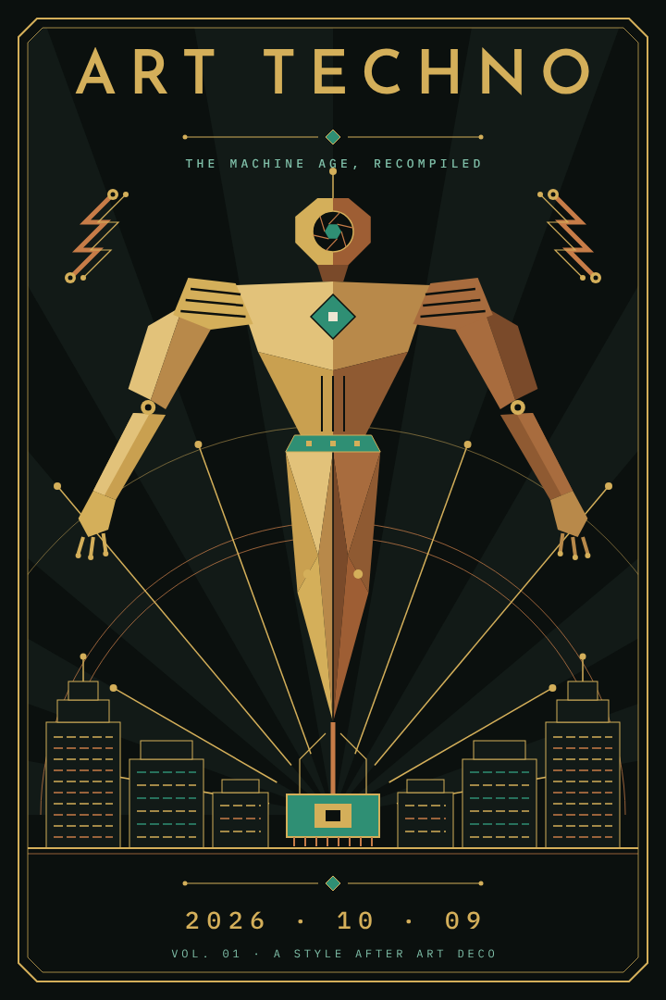 | 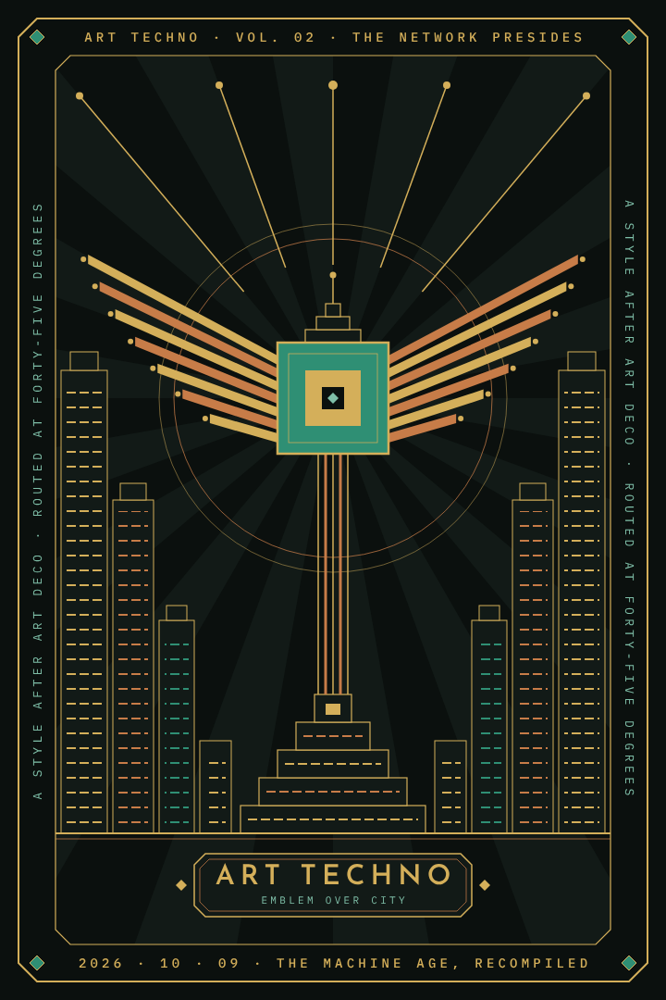 | 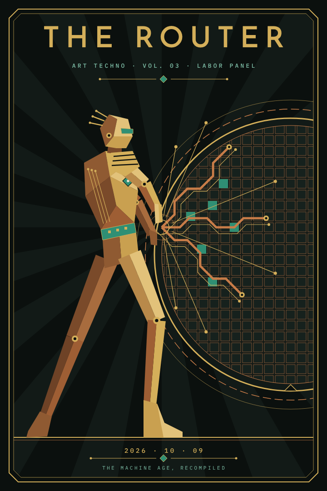 |

The three Deco poster layouts, re-skinned: a central figure ascending over the skyline (after the
Rocketeer poster), an emblem presiding over the city with text around the border (after the Mexico
City poster), and a single figure working a machine (after the gold relief panels).

## Architecture

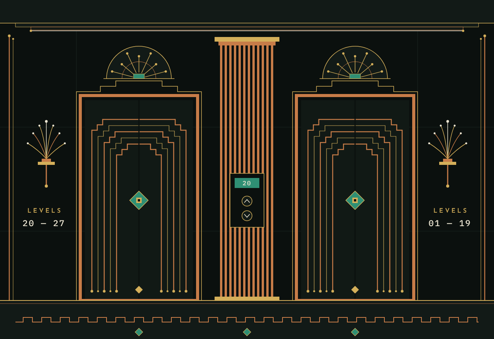

**Elevator lobby.** Black glass and copper trace inlay rising in nested steps, a heat-sink pier
between the doors, a boot-sun fan over each door, and the floor indicator as a die.

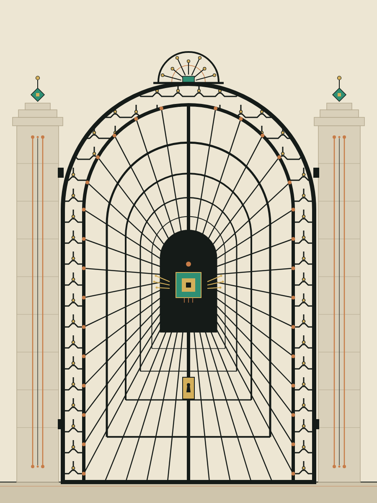

**Garden gate.** The light-ground exception for ironwork: near-black iron on pale stone, scrolls
replaced by routed traces with vias, and the bars receding to a winged chip like a server aisle.

## The Spirits, first studies

| Computation | Knowledge | Ad Astra per Aspera |
| --- | --- | --- |
| 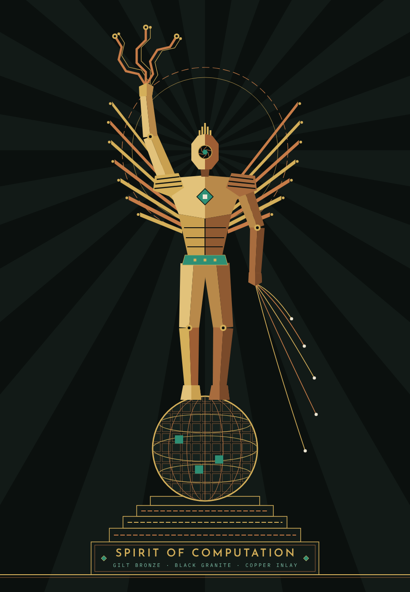 | 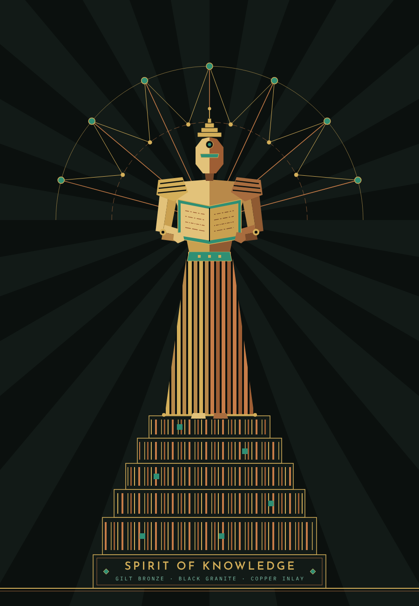 | 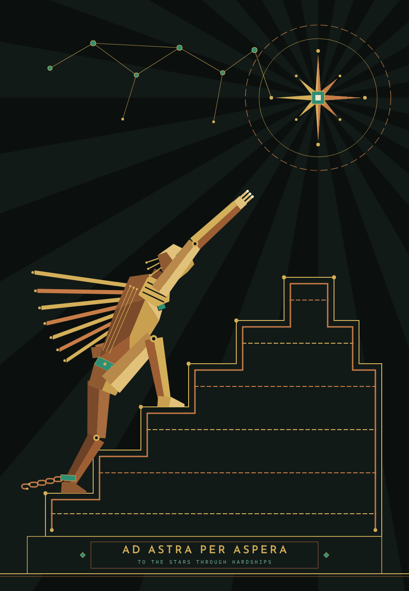 |

| Innovation | Life | Power |
| --- | --- | --- |
| 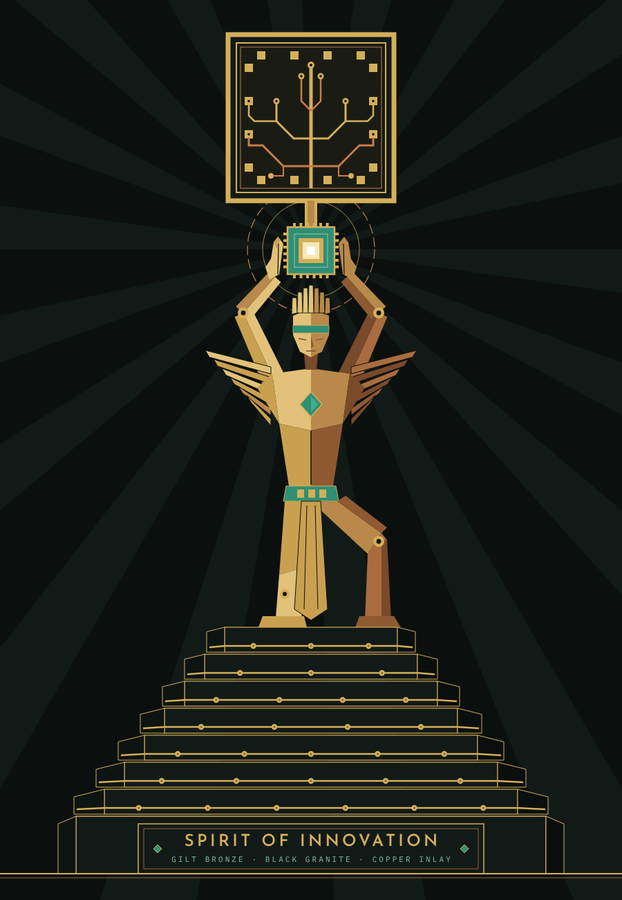 | 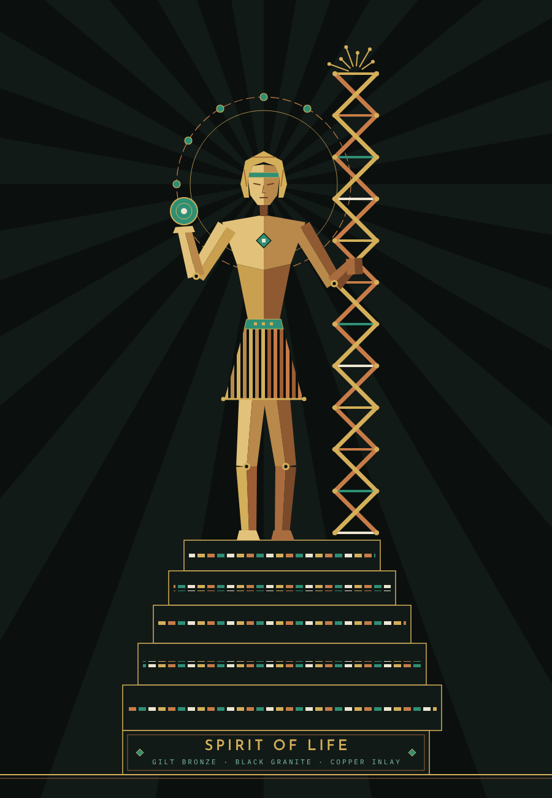 | 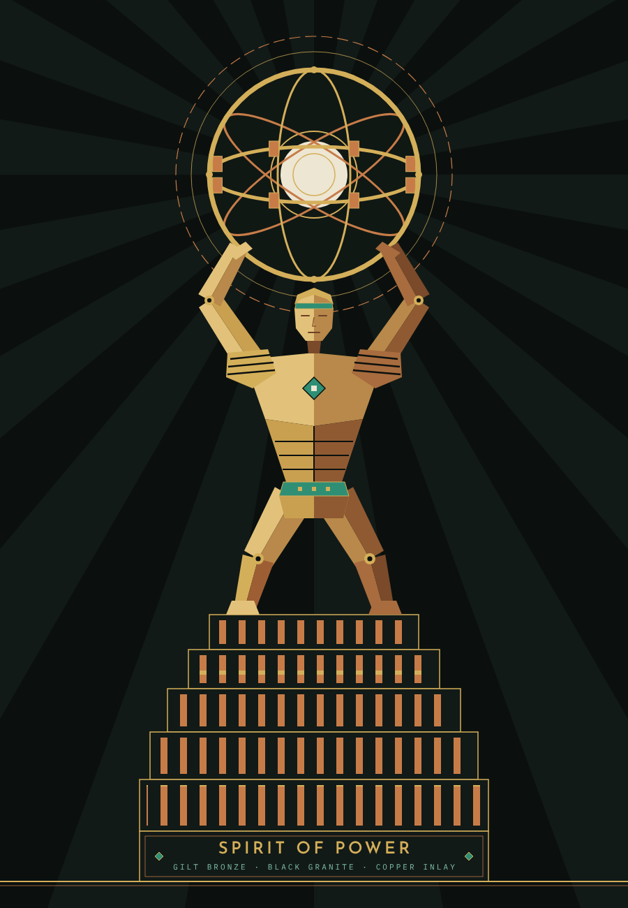 |

These flat studies fixed each Spirit's attribute and pose before the image prompts were written.
The sculpted versions, rendered in Grok and converted to 3D in Meshy, stand in the
[Spirits Plaza](https://flux-frontiers.github.io/art_techno/); its plaque cards show each statue
as placed.
