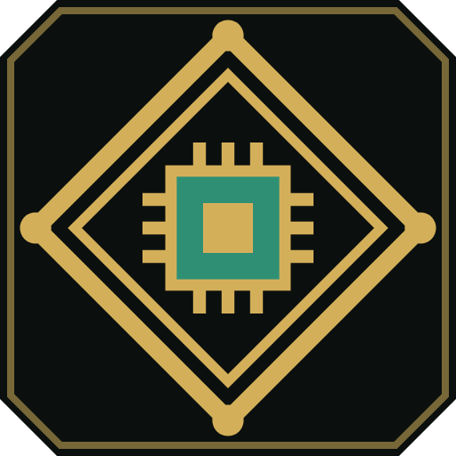
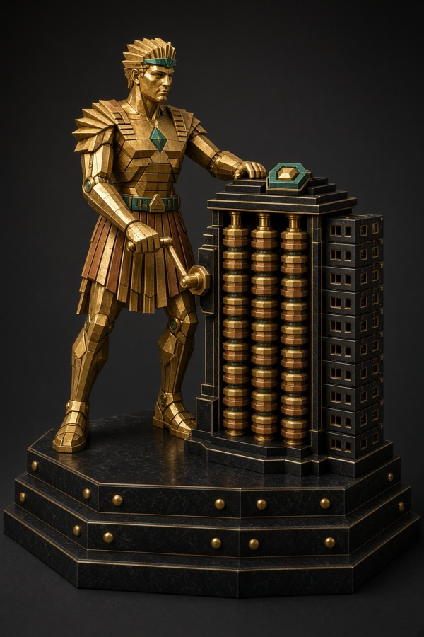
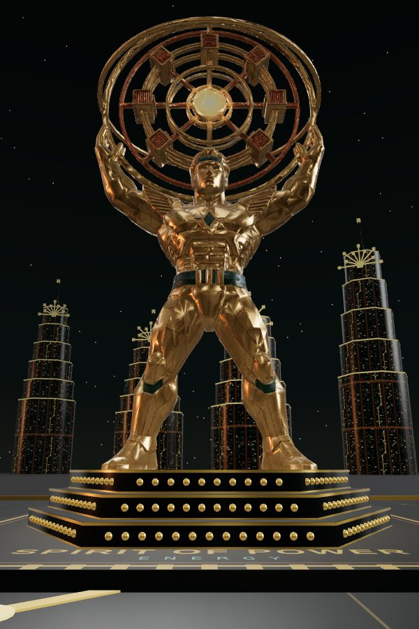
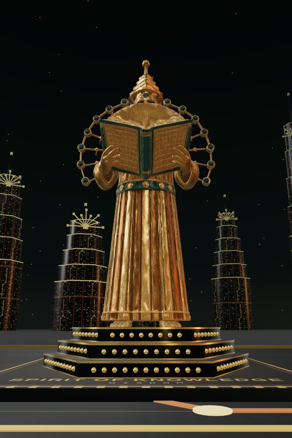
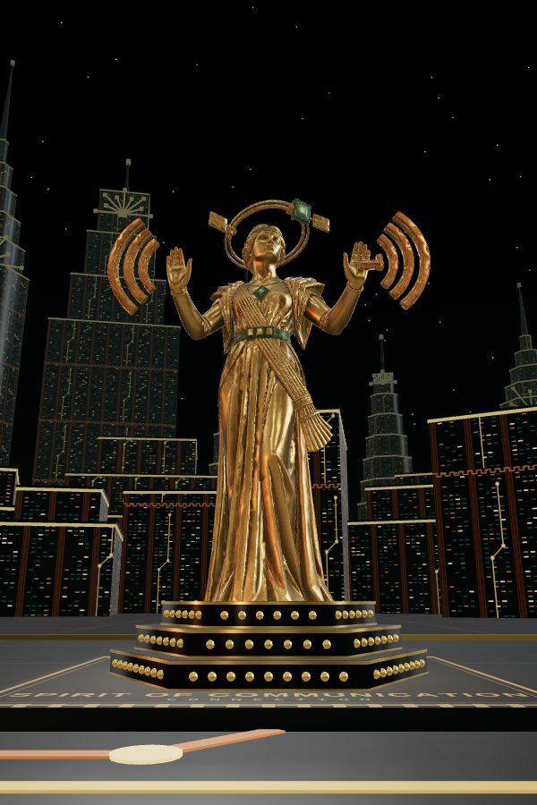
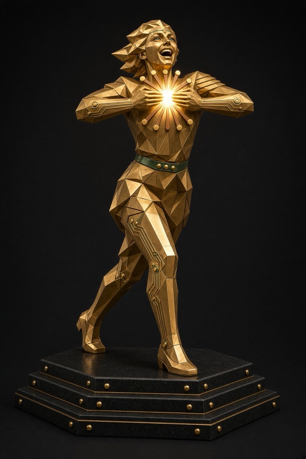
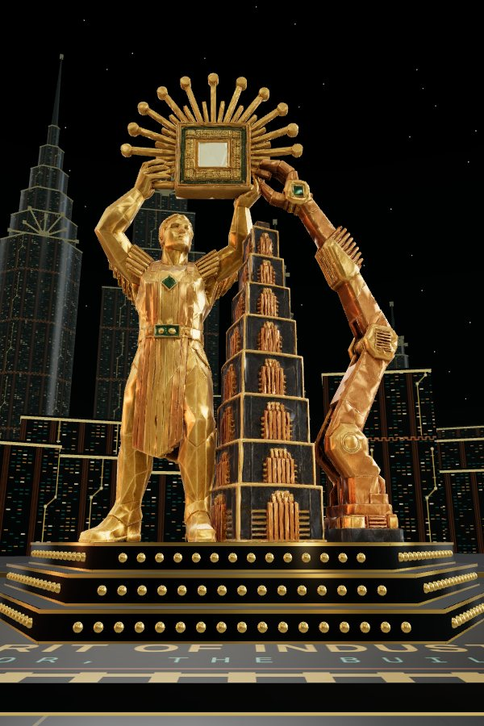
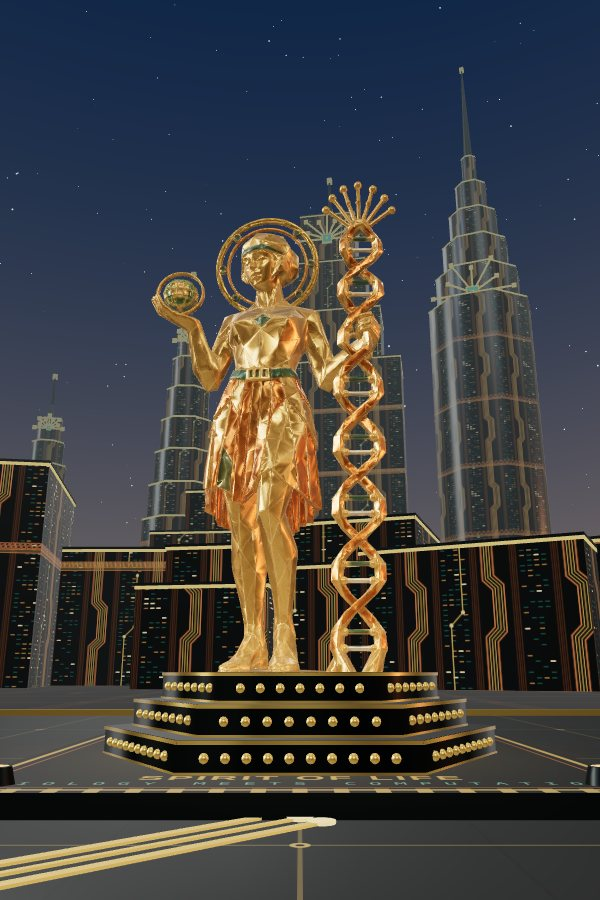
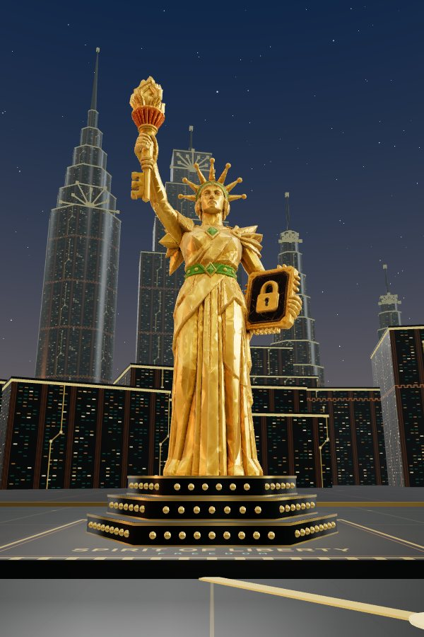
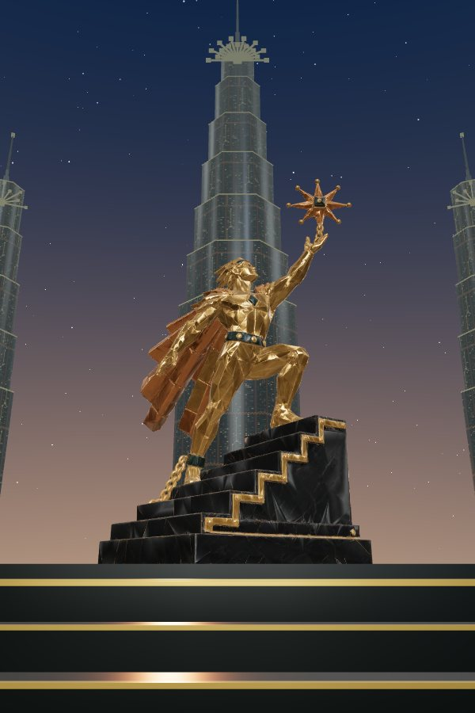

# Art Techno: design

Art Techno does for the computer age what Art Deco did for the machine age: monumental, symmetrical
and luxurious, with circuit-board precision in place of the machine. Where Deco celebrated and
revered the dynamo, the airliner and the skyscraper, Art Techno gives the same devotion to the chip,
the data centre and the satellite.

This is the complete design record. Where everything lives:

- [**Style rules**](STYLE.md): the premise, the Deco grammar, the seven rules, geometry and line,
  palette and materials, the motif lexicon, the figure, lettering, composition, anti-patterns and
  the checklist. Everything below is built to them.
- **This document**: the mark, [The Gilded Circuit](#the-gilded-circuit) and how it is laid out,
  [the nine Spirits](#the-spirits), [the Core and the other architecture](#architecture),
  [the aerial craft](#aerial-craft), the [motif boards](#motifs), the [posters](#posters) and the
  [first studies](#the-spirits-first-studies).
- [**Brand images**](brand/README.md): the README hero, the wordmark lockups, the social card, the
  section rules and the brand board, and which to use where.
- [**The plaza's code**](../web/README.md): how the scene is built, the controls, and how a new
  model is added.
- **Outside this repository**, in the Art Techno project: the image prompts, the model log (every
  Meshy export and what became of it) and the review history of every render.
- **Kept privately**: the design boards and renders, the poster series and the Spirits' first
  studies that this record describes. The sculpted Spirits are shown [below](#the-spirits).

## The mark

The die lozenge (motif 6) is the Art Techno mark: a double diamond frame round a square die,
pin ticks on four sides and a pad at each point, on an obsidian tile with 45-degree corners. It is
already the style's emblem, on The Cloud's flank and the Spirits' chests. The full mark is
[`logo/art-techno-mark.svg`](logo/art-techno-mark.svg); for 32 px and below use the browser-tab
drawing in `web/public/favicon.svg` (one heavy diamond and the die, no hairlines or pins). Gold
#D4AF5A, solder green #2F8F74, obsidian #0B100E; nothing else, and no lettering in the mark.

## The Gilded Circuit

The style's first public square, a walk-through plaza that runs in the browser:
[flux-frontiers.github.io/art_techno](https://flux-frontiers.github.io/art_techno/).

- **The floor is a circuit board.** A processor dais sits at the centre, and traces route from it at
  0, 45 and 90 degrees, as three-trace buses, to a chip-package pad under every statue. Every street
  of the city beyond is a triple run, and buses climb the risers of Ad Astra's terrace.
- **The avenue.** Eight Spirits face each other in pairs down the avenue, each 12 m tall with the
  figure's head at 9.6 m, so they read at one scale whatever they hold (the enthroned Architect's head
  is at 8 m: the same size of person). Each stands on the
  series plinth: three low hexagonal tiers of black granite with gold rails and studs, and no
  lettering. Their names are set on the front edge of the pads.
- **The message.** Ad Astra per Aspera closes the avenue from a raised terrace of six steps, 24 m
  tall, twice the others. Behind him, 300 m out, rises the Core, and from the processor his star is
  held up to its winged chip.
- **The city.** A mirror-symmetric skyline of five kinds of building: setback towers, slabs, spires,
  data halls and low blocks. Bus runs climb their facades, Greek-key and clock-wave friezes run under
  their setbacks, their windows are lit in rows like server racks, and every tower wears a boot-sun
  crown drawn after the Sun Towers': an emerald die seated on a lower roofline inside stepped arcs,
  long gold rays and short copper ones ending in pads, and on most a bus dropping to vias. A light
  haze softens the far skyline.
- **The sky.** Real astronomy for the viewer's time zone: the sun, the moon in its true phase, the
  stars of the Yale Bright Star Catalogue, and meteor showers at their real rates. It is turned so
  the sun sets behind Ad Astra. Dusk, night, dawn, day, or live.
- **Light.** By day the gold carries the sun. After dark the statues are carried by floodlamps at
  their feet, strongest at the base and fading up the figure, and the city's windows, the Core and
  the craft glow from within: light emitted, not reflected (rule 5).
- **Overhead.** The Packet Clipper, The Cloud and Uplink cross the sky at random, routed clear of
  the towers.
- **Scale.** A plain 1.75 m figure can be stood beside every statue, to judge the size by.

## The Spirits

| Computation | Power | Knowledge |
| --- | --- | --- |
|  |  |  |

| Communication | Innovation | Industry |
| --- | --- | --- |
|  |  |  |

| Life | Liberty | Ad Astra per Aspera |
| --- | --- | --- |
|  |  |  |

Nine allegorical statues for the compute age, each a human figure carved in faceted planes (rule 6),
gilt bronze on black granite. Each was drawn to the rules, rendered in Grok and sculpted in Meshy.

| Spirit | Allegory | Attribute | |
| --- | --- | --- | --- |
| Computation | The engine of calculation | Babbage's engine: a crank, columns of figure wheels, punched cards | The Engine. He turns the crank of Babbage's calculating engine, the first design for a computer, rebuilt in gold and black granite: its columns of stacked wheels are the store, its punched cards are the program, and a green die crowns its stepped cornice. Computation as work, done by hand. (The Architect, seated on the memory hierarchy with a processor die and gold dividers, stands as the alternative; his card's Architect button shows him in place.) |
| Power | Energy | A fusion sun held overhead, its power run down his body in gold traces to the ground | Atlas for the age of fusion, and part of the grid. He braces wide and holds overhead a ring of magnet coils round a core shaped like a die, and its power runs down his arms and legs in buses of gold traces to the ground. |
| Knowledge | Wisdom, sent out | An owl of facets and fins on her gauntlet, a slate at her side | The Owl-bearer. She strides out with an owl on her gauntlet, the oldest sign of wisdom, its eyes two glowing dies. At her side, where a book once was, she carries a slate with a die on its lid. The owl is about to fly: knowledge is for sending out. The robed figure she replaced, with an open book and a knowledge-graph halo, read as priestly; it is kept in [`archive/knowledge-priestess`](../archive/knowledge-priestess) as the Knowledge Priestess. |
| Communication | Connection | A broadcast arch held overhead with a satellite at its crest, a bus of signal traces | Connection. She is the transmitter: her raised hands hold up a broadcast arch of stepped Deco wavefronts with a small satellite at its crest, and her signal runs across her body as a bus of gold traces fanning out to glowing pads. |
| Innovation | Invention | A split chip pressed together at her heart, a sunburst breaking out at the seam | Eureka. She has just pressed two halves of a chip together at her heart, and the idea ignites: a sunburst breaks out across her chest, and gold traces carry it down her arms and legs. She springs forward with the joy of it, the only Spirit in motion. (The kneeling figure who lifts a newborn chip beneath its circuit plan stands as the alternative; the card's Kneeling button shows him in place.) |
| Industry | Labor, the Builder | A worker and a robotic arm setting a processor sun on a stepped tower | Human and machine as partners. The Builder and a copper robotic arm lift a processor sun together and set it on top of a stepped server tower, the same rising-sun crown the city's towers wear. |
| Life | Biology meets computation | A double-helix staff rising into a radiant chip, a glowing cell in her palm | Life written in code. She holds the double helix as a staff whose strands feed a chip at its crown, and the chip radiates like the rising sun. In her open palm rests a glowing cell. |
| Liberty | Freedom | A torch with a keyhole cut through its flame, a sealed tablet with a padlock | Freedom in the computer age is privacy. Liberty holds a torch like a scepter, a keyhole cut through its stepped flame, and presses to her heart a tablet framed like a chip package, sealed with a padlock: the right to keep what is yours. |
| Ad Astra per Aspera | Aspiration | A climb that ends with a chip-hearted star in hand | Through hardship to the stars. A figure climbs a flight of steps and takes hold of a star with a chip for a heart, a broken chain at his ankle. The climb is the point: he stands twice as tall as the others and closes the avenue. |

Rules the series keeps: human, bare faces (no visors or robot masks); the series plinth, three tiers
at most and never lettered; green under a tenth of the area; every line ending in a pad.

## Architecture

### The Core

**The Core** is the city's great tower, and the style's fullest statement at the scale of
architecture. It stands on the avenue's axis behind Ad Astra per Aspera, and every motif on it
serves one climb. Read it from the ground up, like a signal path.

- **Forecourt.** Gold traces in the paving converge on the door, inside a Greek-key border
  (motif 14). Two fibre fountains (motif 10) stand at the threshold, each strand tipped with light.
- **Portal.** Nested stepped arches drawn as routed traces, every line ending in a pad (rule 3).
  A half-fan transom rises from a small chip over the doors (motif 1), and a die lozenge
  (motif 6) sits at the arch's peak.
- **Guardians.** Two colossal operators in faceted gold armour stand on stepped plinths either
  side of the door. Each holds up a glowing chip-sun. Unlike the Spirits, who are bare-faced
  allegories, they are the building's sentries, crested and helmed.
- **Spine.** From the portal, copper heat-sink piers (motif 5) rise in stepped flutes, and
  between them a bus of gold vias climbs the axis (motif 13), its traces jogging at 45 degrees.
- **Facade.** Stacked server layers with 45-degree chamfers, each setback edged in gold and
  studded with pads at its corners (rule 4). Greek-key friezes run along the setbacks, iris
  portholes (motif 8) are set in pairs, and the window bays are lit in rows like server racks
  (rule 5).
- **Winged die.** The spine ends in a solder-green chip with a gold die, its swept wings of stacked
  gold and copper fins spread like an eagle's (motif 7).
- **Crown.** Above it, a boot sun (motif 1): a chip with rays alternating long and short, each
  ending in a pad, flanked by green graph fans (motif 11). Faint wavefront arcs ring the crown, and
  the stepped spire ends in a single glowing pad.
- **Wings.** Lower stepped server halls either side, their windows lit in rows.

**In the plaza.** The Core closes the avenue, 300 m beyond the plaza and 172 m tall. From the
processor at the plaza's heart, Ad Astra's star sits right on its winged chip: the figure lifts
the star to the building's emblem, and the whole avenue resolves into one image. From the entrance,
the star rises against the copper piers of its spine. The Core was rendered in Grok from
the tower prompt (kept with the other prompts, outside this repository) and sculpted in Meshy as one
deep relief.
It is only ever seen head-on, which suits it. In the plaza its gold glows faintly after dark.

### The Sun Towers

**The Sun Towers** are a matched pair of the city's towers, one model drawn twice, mirrored across
the avenue where the ring of towers comes nearest the Core. Each wears the boot sun as a crown
(rule 1): a processor die seated on a setback like the sun on the horizon, inside stepped arcs
that alias the curve (rule 4), its long gold rays and short copper rays each ending in a pad
(rule 3), and a bus of six traces dropping down the face below, bending at 45 degrees into ring
vias (rule 2). The crown grows out of the setbacks rather than sitting on a wall. At 120 m they
stand under the Core, and from the processor they frame it like gateposts: three crowned towers
close the avenue.

### Interiors and ironwork

**Elevator lobby.** Black glass and copper trace inlay rising in nested steps, a heat-sink pier
between the doors, a boot-sun fan over each door, and the floor indicator as a die.

**Garden gate.** The light-ground exception for ironwork: near-black iron on pale stone, scrolls
replaced by routed traces with vias, and the bars receding to a winged chip like a server aisle.

## Aerial craft

Deco's airliner, rocket and zeppelin, rebuilt from present-day flight under the seven rules: wings
swept at exactly 45 degrees, a rocket stacked like a server, a hull ruled like a circuit board,
iris portholes for every fan, server lights for every window, and a flame drawn as emitted light.
All three fly across the plaza's sky, built in code from these boards.

Rendered in Grok from their prompts and converted to 3D in Meshy, all three fly in the plaza in place
of their code-built versions. Uplink's flame and fan of rays are still drawn in code, as emitted light.

## Motifs

**Motif 13, the bus run.** Many traces at one pitch, running long and straight, turning together
through nested 45-degree bends and fanning out to staggered pads. The rules are in
[STYLE.md](STYLE.md#the-bus-run). In the plaza, buses climb every tower facade, string courses run
under each frieze, the floor routes from the processor run as three-trace buses, and every street of
the city is a triple run.

## Posters

The three Deco poster layouts, re-skinned: a central figure ascending over the skyline (after the
Rocketeer poster), an emblem presiding over the city with text around the border (after the Mexico
City poster), and a single figure working a machine (after the gold relief panels).

## The Spirits, first studies

These flat studies fixed each Spirit's attribute and pose before the image prompts were written.
Some were superseded on the way: Computation's study, bolts over a wafer globe, gave way first to the
Architect (the globe belonged to Communication) and then to the Engine (the enthroned Architect read
as priestly). The sculpted Spirits are [above](#the-spirits).
