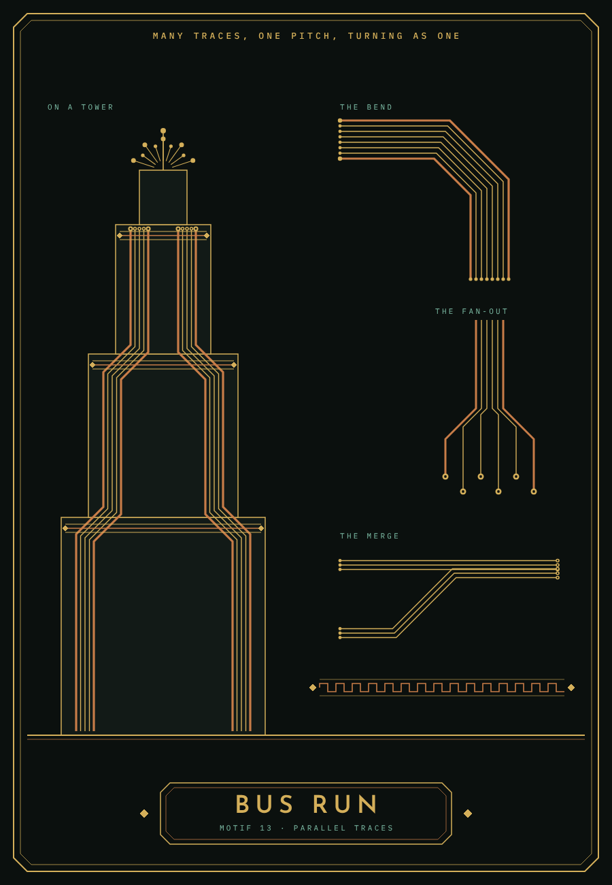
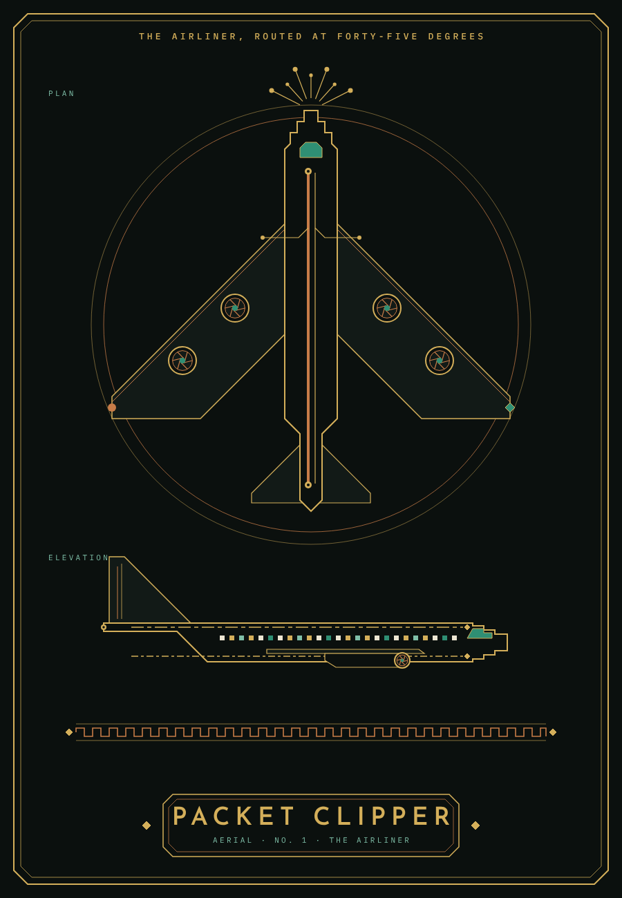
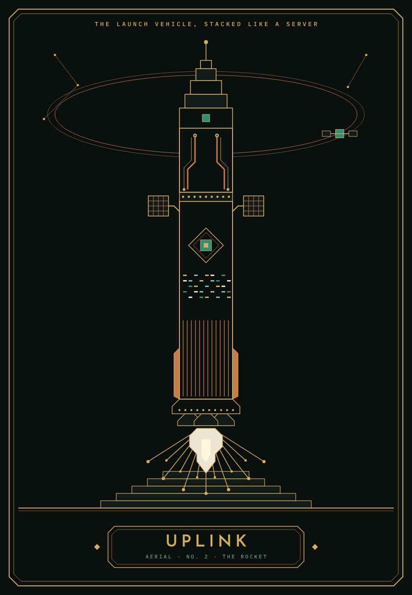
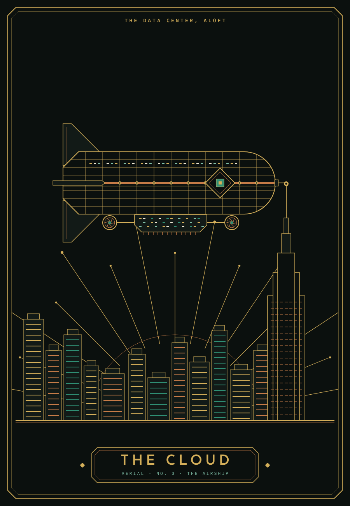
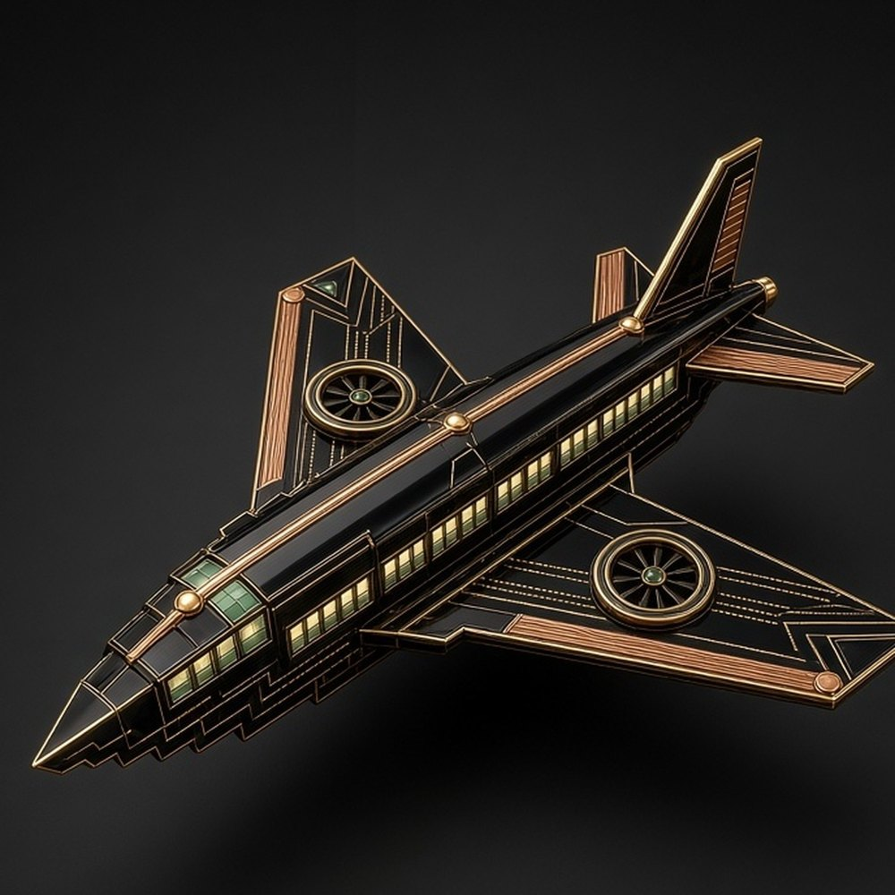
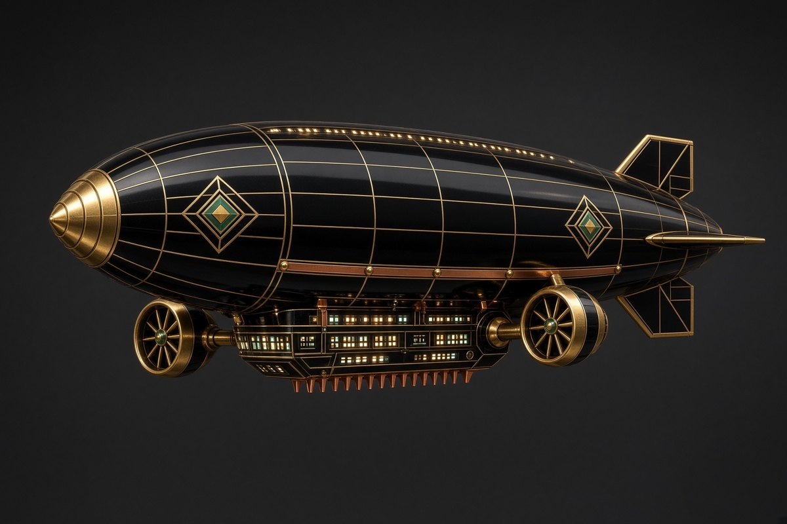
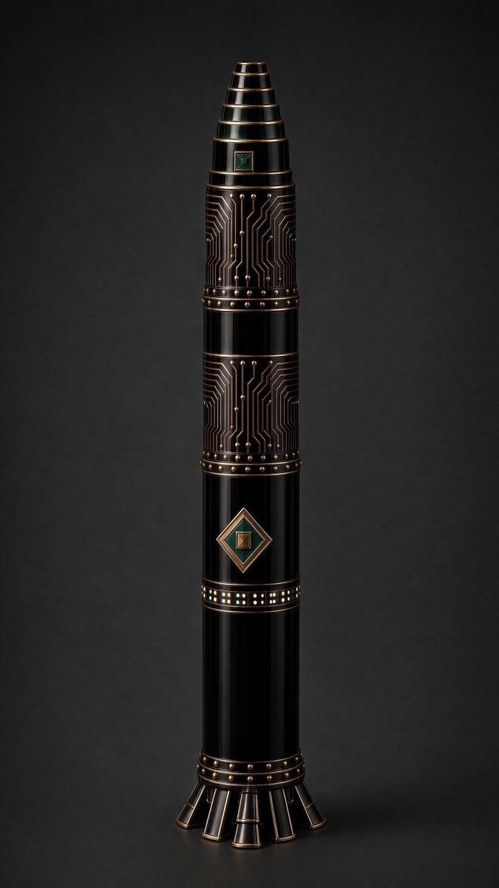
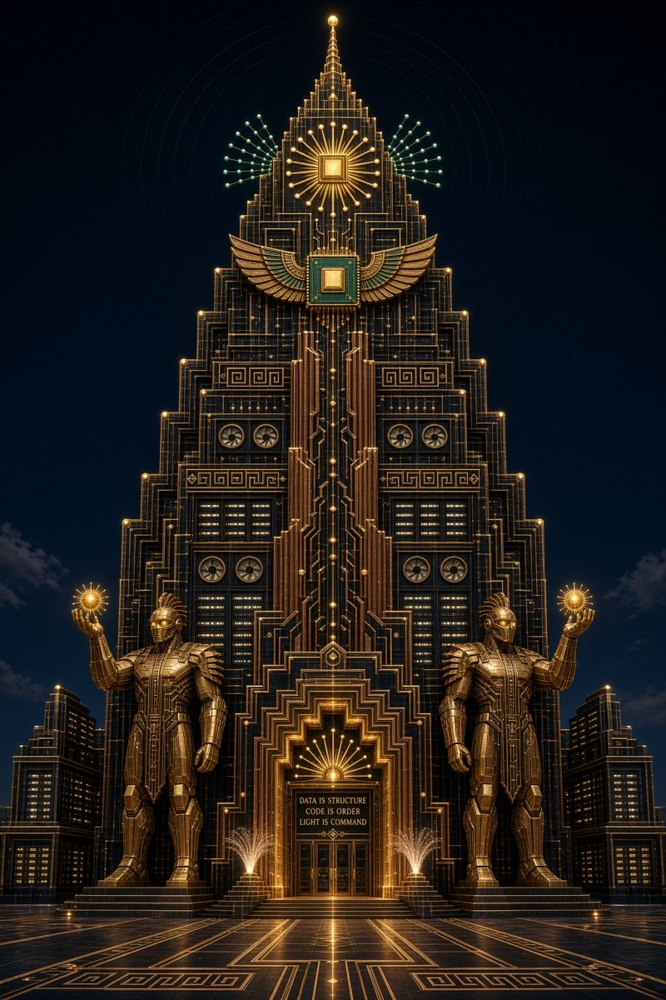
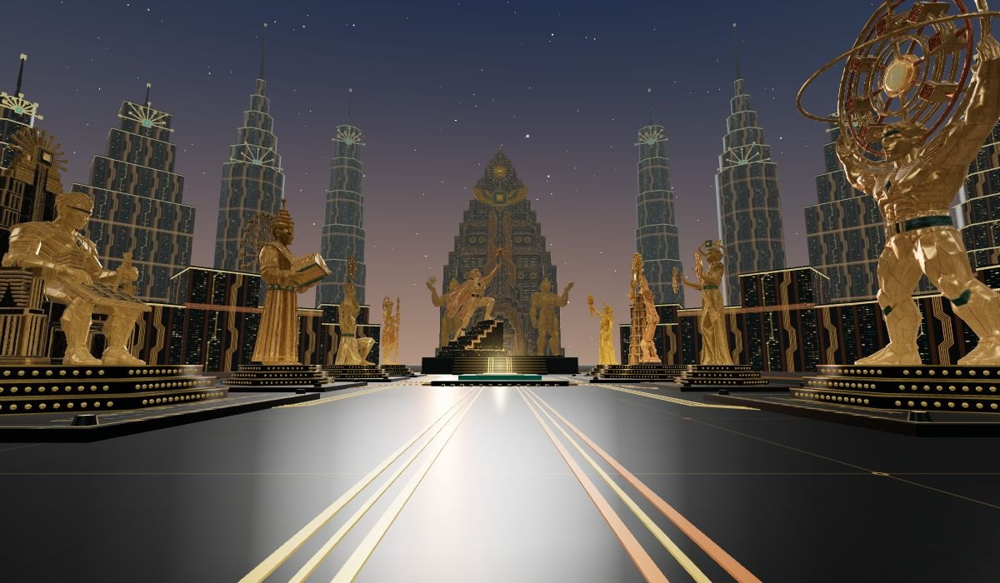

# Art Techno: design docs

- [**Style Rules**](STYLE.md): the premise, the Deco grammar, the seven rules, geometry and line,
  palette and materials, the motif lexicon, the figure, lettering, composition, anti-patterns and
  the checklist.
- **Design boards** (below): the first studies in the style, drawn as flat vector art to the rules.
  They came before the Spirits were sculpted, and set the vocabulary the statues and the plaza use.

## The mark

The die lozenge (motif 6) is the Art Techno mark: a double diamond frame round a square die,
pin ticks on four sides and a pad at each point, on an obsidian tile with 45-degree corners. It is
already the style's emblem, on The Cloud's flank and the Spirits' chests. The full mark is
[`logo/art-techno-mark.svg`](logo/art-techno-mark.svg); for 32 px and below use the browser-tab
drawing in `web/public/favicon.svg` (one heavy diamond and the die, no hairlines or pins). Gold
#D4AF5A, solder green #2F8F74, obsidian #0B100E; nothing else, and no lettering in the mark.

## Motifs

**Motif 13, the bus run.** Many traces at one pitch, running long and straight, turning together
through nested 45-degree bends and fanning out to staggered pads. The rules are in
[STYLE.md](STYLE.md#the-bus-run). In the plaza, buses climb every tower facade, string courses run
under each frieze, the floor routes from the processor run as three-trace buses, and every street of
the city is a triple run.

## Aerial craft

| Packet Clipper | Uplink | The Cloud |
| --- | --- | --- |
|  |  |  |

Deco's airliner, rocket and zeppelin, rebuilt from present-day flight under the seven rules: wings
swept at exactly 45 degrees, a rocket stacked like a server, a hull ruled like a circuit board,
iris portholes for every fan, server lights for every window, and a flame drawn as emitted light.
All three fly across the plaza's sky, built in code from these boards.

| The Packet Clipper, sculpted | The Cloud, sculpted | Uplink, sculpted |
| --- | --- | --- |
|  |  |  |

Rendered in Grok from their prompts and converted to 3D in Meshy, all three fly in the plaza in place
of their code-built versions. Uplink's flame and fan of rays are still drawn in code, as emitted light.

## Posters

| Ascension | Emblem over city | The router |
| --- | --- | --- |
|  |  |  |

The three Deco poster layouts, re-skinned: a central figure ascending over the skyline (after the
Rocketeer poster), an emblem presiding over the city with text around the border (after the Mexico
City poster), and a single figure working a machine (after the gold relief panels).

## Architecture

### The Core

**The Core** is the city's great tower, and the style's fullest statement at the scale of
architecture. It stands on the avenue's axis behind Ad Astra per Aspera, and every motif on it
serves one climb. Read it from the ground up, like a signal path.

- **Forecourt.** Gold traces in the paving converge on the door, inside a Greek-key border
  (motif 14). Two fibre fountains (motif 10) stand at the threshold, each strand tipped with light.
- **Portal.** Nested stepped arches drawn as routed traces, every line ending in a pad (rule 3).
  A half-fan transom rises from a small chip over the doors (motif 1), and a die lozenge
  (motif 6) sits at the arch's peak.
- **Guardians.** Two colossal operators in faceted gold armour stand on stepped plinths either
  side of the door. Each holds up a glowing chip-sun. Unlike the Spirits, who are bare-faced
  allegories, they are the building's sentries, crested and helmed.
- **Spine.** From the portal, copper heat-sink piers (motif 5) rise in stepped flutes, and
  between them a bus of gold vias climbs the axis (motif 13), its traces jogging at 45 degrees.
- **Facade.** Stacked server layers with 45-degree chamfers, each setback edged in gold and
  studded with pads at its corners (rule 4). Greek-key friezes run along the setbacks, iris
  portholes (motif 8) are set in pairs, and the window bays are lit in rows like server racks
  (rule 5).
- **Winged die.** The spine ends in a solder-green chip with a gold die, its swept wings of stacked
  gold and copper fins spread like an eagle's (motif 7).
- **Crown.** Above it, a boot sun (motif 1): a chip with rays alternating long and short, each
  ending in a pad, flanked by green graph fans (motif 11). Faint wavefront arcs ring the crown, and
  the stepped spire ends in a single glowing pad.
- **Wings.** Lower stepped server halls either side, their windows lit in rows.

**In the plaza.** The Core closes the avenue, 300 m beyond the plaza and 172 m tall. From the
processor at the plaza's heart, Ad Astra's star sits right on its winged chip: the figure lifts
the star to the building's emblem, and the whole avenue resolves into one image. From the entrance,
the star rises against the copper piers of its spine. The Core was rendered in Grok from
the tower prompt (kept with the other prompts, outside this repository) and sculpted in Meshy as one
deep relief.
It is only ever seen head-on, which suits it. In the plaza its gold glows faintly after dark.

### Interiors and ironwork

**Elevator lobby.** Black glass and copper trace inlay rising in nested steps, a heat-sink pier
between the doors, a boot-sun fan over each door, and the floor indicator as a die.

**Garden gate.** The light-ground exception for ironwork: near-black iron on pale stone, scrolls
replaced by routed traces with vias, and the bars receding to a winged chip like a server aisle.

## The Spirits, first studies

| Computation | Knowledge | Ad Astra per Aspera |
| --- | --- | --- |
|  |  |  |

| Innovation | Life | Power |
| --- | --- | --- |
|  |  |  |

These flat studies fixed each Spirit's attribute and pose before the image prompts were written.
The sculpted versions, rendered in Grok and converted to 3D in Meshy, stand in the
[The Gilded Circuit](https://flux-frontiers.github.io/art_techno/); its plaque cards show each statue
as placed.
