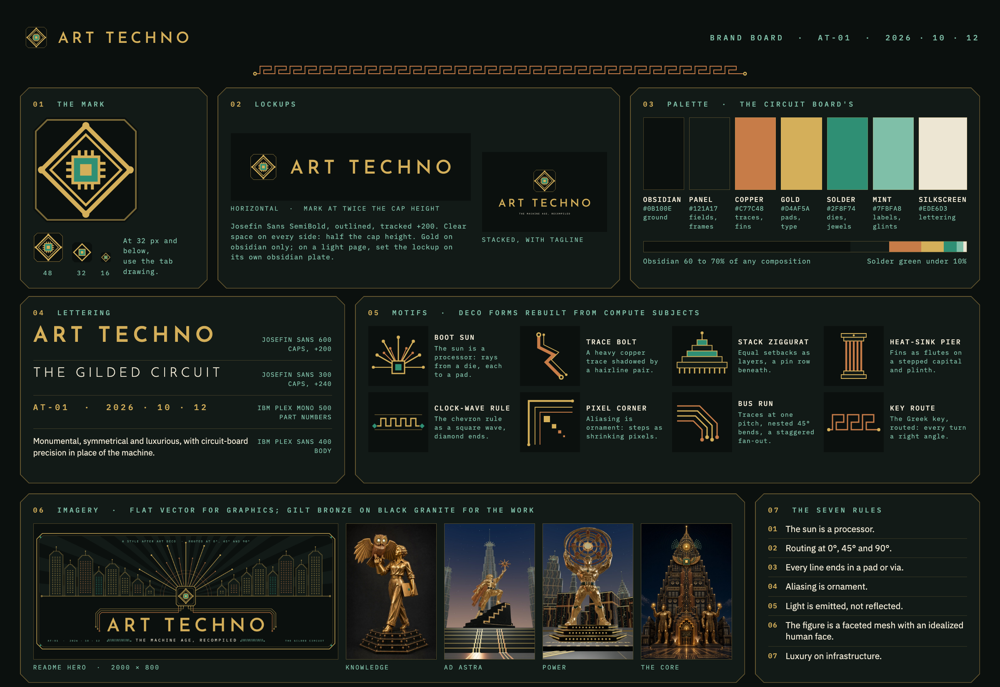

# Art Techno: brand images



The images for presenting Art Techno itself: in a README, on a social card, at the head of a document
or a slide. They are drawn to the [style rules](../STYLE.md), which hold the palette, the lettering and the
motifs in full; this page covers only which file to use where.

## The files

| File | Size | Use |
| --- | --- | --- |
| [`hero.png`](hero.png) | 2000 x 800 | The README hero. Display at up to 1000 px wide. |
| [`social-card.png`](social-card.png) | 1280 x 640 | GitHub social preview, Zenodo, link cards. |
| [`wordmark.svg`](wordmark.svg) | vector | The horizontal lockup: the mark and ART TECHNO. Headers, title slides. |
| [`wordmark-stacked.svg`](wordmark-stacked.svg) | vector | The stacked lockup with the tagline. Covers, square formats. |
| [`rule-clock-wave.svg`](rule-clock-wave.svg) | vector | Section rule (motif 4), gold on obsidian. |
| [`rule-key-route.svg`](rule-key-route.svg) | vector | Section rule (motif 14), copper on obsidian. |
| [`brand-board.png`](brand-board.png) | 2400 x 1650 | The whole system on one sheet. |
| [`../logo/art-techno-mark.svg`](../logo/art-techno-mark.svg) | vector | The mark alone. Avatars, badges, anything square. |

## Using the lockups

- **Gold on obsidian only.** The wordmark SVGs have a transparent ground and gold letters, for dark
  pages. On a light page, set the lockup on its own obsidian plate; never recolor it.
- **Clear space:** half the cap height on every side.
- **Minimum size:** the horizontal lockup at 260 px wide, the stacked lockup at 140 px, which keeps
  the mark in each at 32 px or more. Below that, use the mark alone, and at 32 px and below the browser-tab drawing in
  [`web/public/favicon.svg`](../../web/public/favicon.svg).
- **The tagline** is "The machine age, recompiled". Set it only in IBM Plex Mono capitals, under the
  wordmark, as the stacked lockup and the hero do.
- **Don't** stretch, outline, shadow, add glow to, or rotate the lockups, and don't reset the wordmark
  in another face.

## Lettering

The wordmark is Josefin Sans SemiBold, tracked +200, with the letters outlined to paths, so the SVGs
render the same everywhere, including in a GitHub README. Josefin already has the Deco forms the style
asks for: the pointed A and the circular O. Set running display text in Josefin Sans,
part numbers and captions in IBM Plex Mono, and body text in IBM Plex Sans, as the plaza does.

## Rebuilding

[`build.py`](build.py) draws the hero, the social card, the lockups and the rules, then renders the
PNGs, and the brand board from [`brand-board.html`](brand-board.html), with headless Chrome:

```bash
uv run --with fonttools docs/brand/build.py
# or, without uv:
python3 -m pip install fonttools && python3 docs/brand/build.py
```

It fetches Josefin Sans and IBM Plex Mono into `~/.cache/art-techno-fonts` on its first run. Set
`CHROME` to the browser binary if it is not at the default macOS path. The brand board loads its fonts
from Google Fonts, so it needs a network connection to render.
